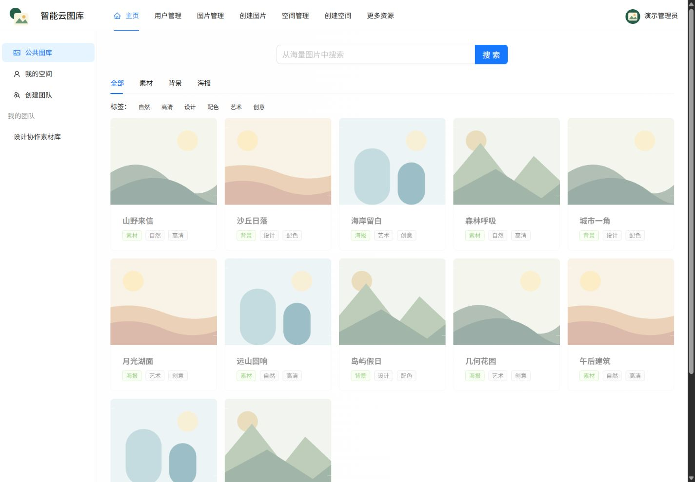
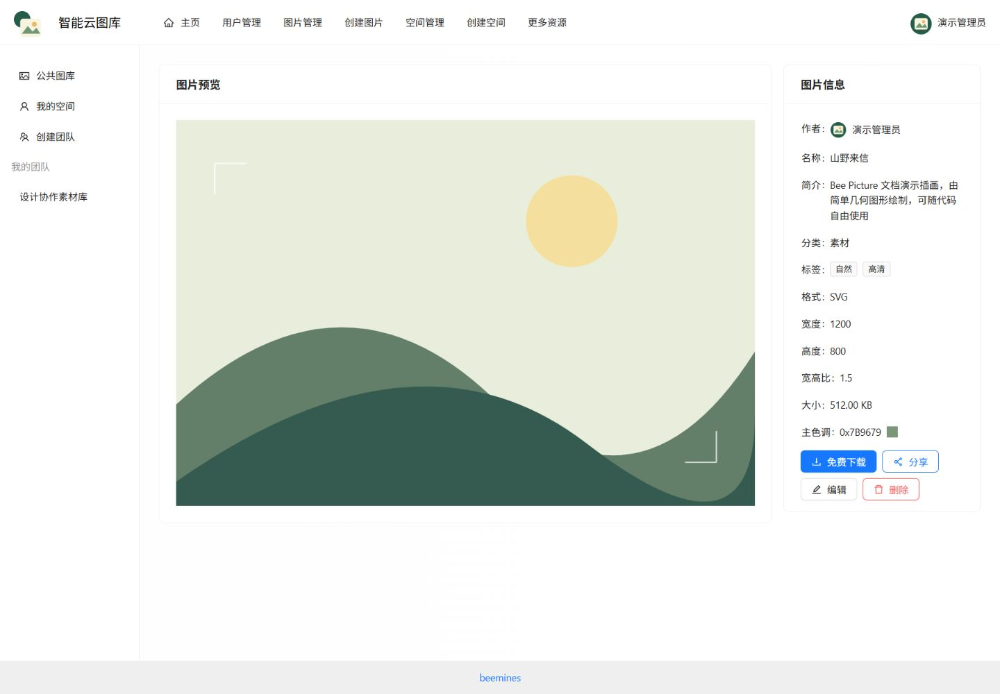
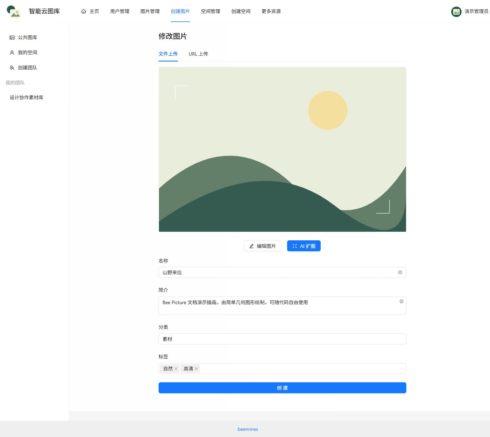
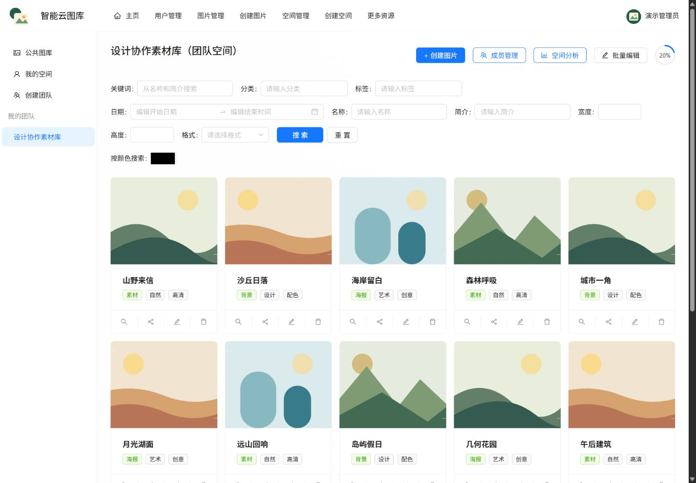
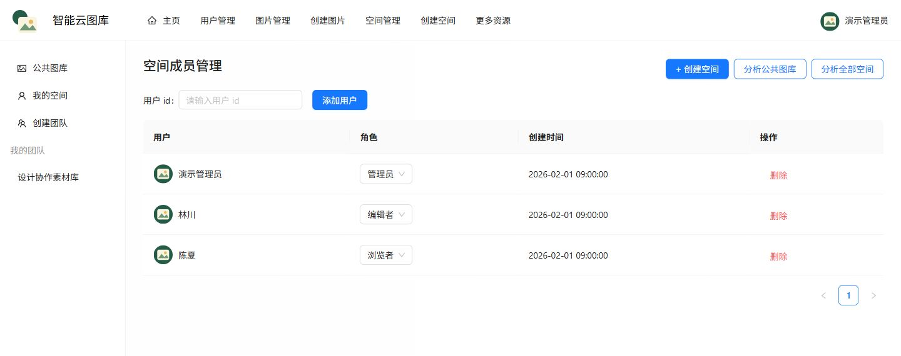
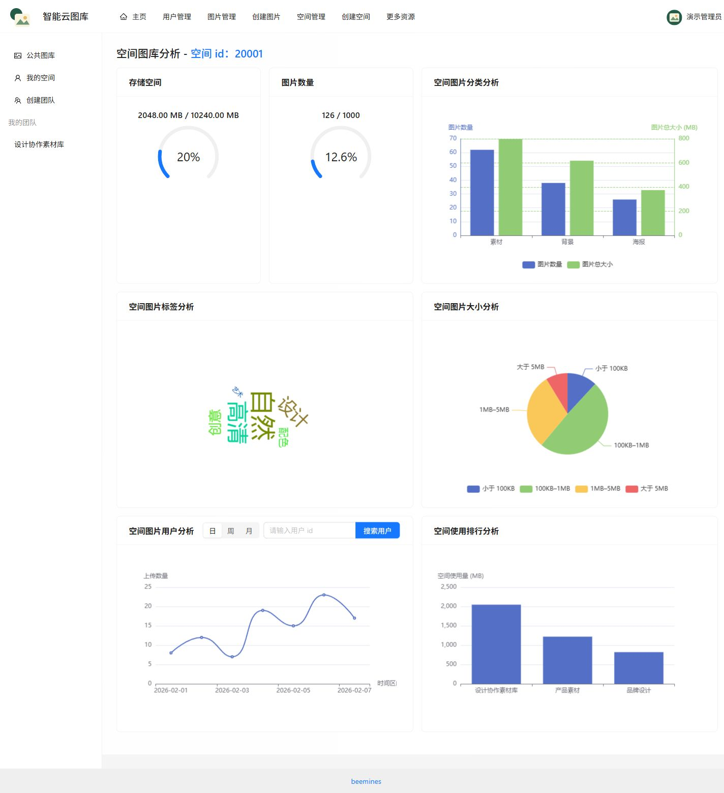
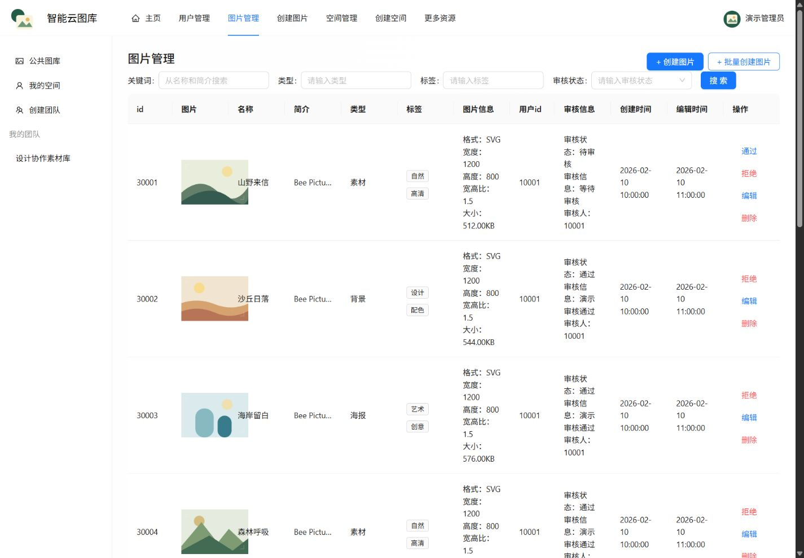
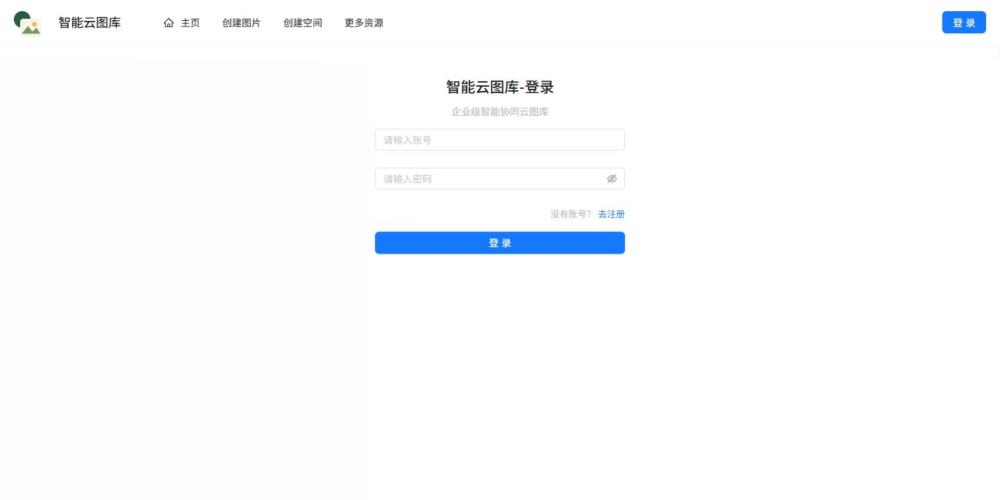
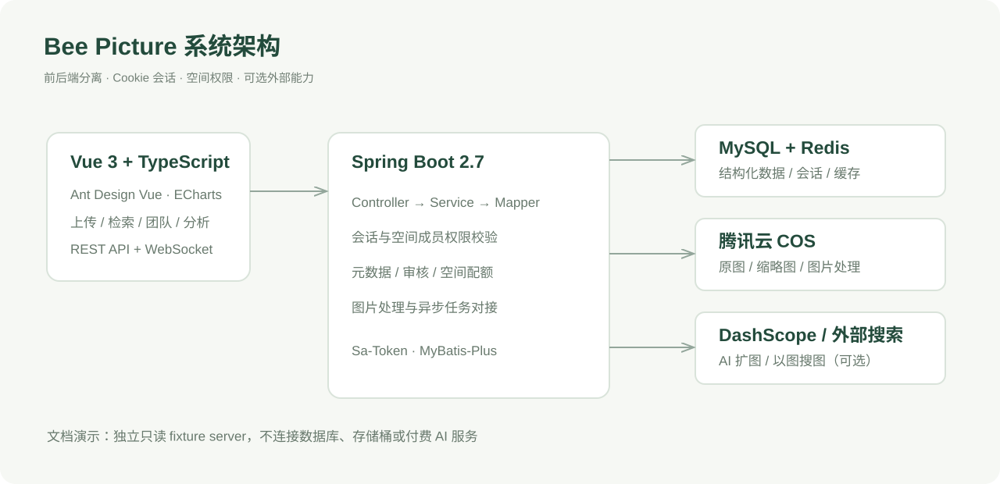

<div align="center">
  
  <h1>Bee Picture 智能云图库</h1>
  <p>从图片收集到团队协作，把素材放在有条理的地方</p>
  <p>
    
    
    
    
    <a href="LICENSE"></a>
  </p>
  <p><a href="#功能导览">功能导览</a> · <a href="#快速开始">快速开始</a> · <a href="#只看界面与文档演示">只看界面</a> · <a href="docs/configuration.md">配置指南</a> · <a href="SECURITY.md">安全说明</a></p>
</div>



## 项目介绍

Bee Picture 是一个前后端分离的图片管理与协作项目。它把分散在本地、网页和工作目录里的图片，组织成可以搜索、分类、标注和共享的图库：个人可以建立自己的素材空间，团队可以在同一个空间中按角色协作，管理员可以集中审核图片和管理资源。

项目围绕一张图片的使用过程组织功能：**上传与收集 → 分类和检索 → 查看与编辑 → 空间协作 → 审核与统计**。图片文件保存在自己的腾讯云 COS 存储桶，MySQL 保存图片、用户和空间元数据，Redis 承担会话与缓存；Vue 界面提供统一的操作入口。

这个仓库适合学习 Java / Vue 全栈开发、图片资源管理、基于空间的权限控制，以及在已有应用中接入 WebSocket 和异步 AI 任务。它是工程实践项目，当前安全设计及外部服务限制见 [SECURITY.md](SECURITY.md)，不宣称可直接投入生产。

**截图说明：**下方图片来自项目真实前端，使用 `docs/demo` 的虚构账号、统计数据和原创 SVG 插画。演示不连接个人数据库、原存储桶或付费 AI 服务；不会把文档演示结果冒充真实的云端处理结果。

## 功能导览

### 1 图片发现与分类检索

公共图库将图片缩略图、名称、分类和标签放在同一张卡片中。用户可以输入关键词，组合分类与标签过滤，再通过分页浏览结果。适合从已有素材中找到背景、海报、设计参考等资源，减少重复收集。

- 关键词检索，分类切换与多标签筛选。
- 图片卡片、缩略图和分页浏览。
- 公共图库与空间内图片分别组织，空间权限由后端校验。


### 2 图片详情与共享

详情页把预览和结构化信息并排展示：作者、名称、简介、标签、格式、宽高、体积、宽高比和主色调都能查看。需要复用素材时可以下载图片，或生成指向详情页的分享链接；编辑、删除入口按返回的权限列表显示。

分享链接沿用当前访问权限，不会自动把私有空间图片改成公开资源。



### 3 图片上传 编辑与 AI 扩图入口

创建页面支持文件上传和 URL 上传，保存图片后可以补充名称、简介、分类和标签。编辑流程包含图片裁剪，以及基于 DashScope 异步任务的 AI 扩图入口；任务创建、状态查询和应用结果由前后端分别协作完成。

- 文件、URL 两种上传方式，管理员还可使用批量抓取入口。
- 图片元信息提取、缩略图及主色调处理对接 COS。
- 裁剪、编辑与批量元信息修改。
- AI 扩图需要单独配置 API Key 和服务权限，可能产生费用；配图只展示操作界面，未调用真实生成任务。



### 4 个人空间与团队素材库

空间为图片提供独立的组织边界。个人空间用于管理自己的素材，团队空间用于汇集共同使用的图片。空间拥有容量与图片数量配额，并提供组合检索、颜色筛选、批量编辑等操作入口。



### 5 成员角色与协作

团队成员拥有浏览者、编辑者、管理员三种角色。空间成员管理页面可以查看成员、分配角色和移除成员，后端使用 Sa-Token 与空间上下文检查具体操作权限。项目还保留了 WebSocket + Disruptor 图片协同编辑链路，用于传递编辑事件。

协作链路依赖会话 Cookie、WebSocket 握手和实际反向代理配置；文档截图不代表已经完成多用户并发与生产压力验证。



### 6 空间统计与可视化

空间分析页面将容量、图片数量、分类、标签、文件大小区间和上传时间分布转成图表。管理员还可以查看空间使用排行，帮助理解素材的构成与存储使用情况。

图表通过 ECharts 呈现，数据由后端分析接口聚合；下图中的数值均为演示数据。



### 7 管理端与图片审核

管理端集中展示图片、用户和空间记录。图片管理支持条件过滤、元数据查看和审核通过 / 拒绝操作，方便把公共图库的展示内容与日常管理流程分开。

管理员权限必须在自己的环境中配置；仓库不提供可登录真实后端的默认管理员账号或生产数据。



### 8 账号入口

用户通过注册和登录建立会话，登录后再进入个人空间或团队空间。当前实现采用 Spring Session + Redis 和 Sa-Token 的组合，生产使用前应按安全说明升级密码方案、初始密码策略与登录风控。



## 系统架构



| 层级 | 技术 | 职责 |
| --- | --- | --- |
| 前端 | Vue 3、TypeScript、Vite、Pinia、Vue Router | 页面、会话状态、路由和接口调用 |
| 组件与图表 | Ant Design Vue、ECharts、vue-cropper | 表单、管理表格、统计图表和图片编辑 |
| 后端 | Java 11、Spring Boot 2.7.6、Spring MVC | REST API、业务校验和服务编排 |
| 数据 | MyBatis-Plus、MySQL、Redis、Caffeine | 元数据、逻辑删除、会话和缓存 |
| 权限与协作 | Sa-Token、WebSocket、Disruptor | 空间权限、事件传递和协同编辑链路 |
| 外部能力 | 腾讯云 COS、DashScope、图片搜索服务 | 图片存储处理、AI 扩图和外部检索 |

**范围说明：**本仓库只包含普通分层架构版本，不含本地的 DDD 版本。源码中的动态分表实验尚未启用，启动类排除了 ShardingSphere 自动配置；README 不将其列为已启用功能。

## 快速开始

### 环境要求

- JDK 11，Maven 3.8 或更高版本。
- Node.js 22 LTS 与 npm。
- MySQL 8、Redis 6 或更高版本。
- 如需真实图片上传和处理：自己的腾讯云 COS 存储桶及最小权限凭据。
- 如需 AI 扩图：自己的 DashScope API Key，并开通对应服务。

### 1 克隆并初始化数据库

```bash
git clone https://github.com/beemines/bee-picture.git
cd bee-picture
mysql -u root -p < backend/sql/create_table.sql
```

该 SQL 是**空数据库的一次性初始化脚本**，包含建表和后续 `ALTER TABLE`。请先阅读脚本；不要重复执行到已有数据库，也不要把它当作自动迁移系统。它不包含用户数据、图片记录或账号密码。

PowerShell 不支持上述 `<` 重定向时，可先进入 `mysql -u root -p`，然后执行 `SOURCE backend/sql/create_table.sql`。确保 Redis 已运行。

### 2 配置并启动后端

在启动后端的同一个 PowerShell 窗口设置自己的配置：

```powershell
$env:DB_USERNAME = "root"
$env:DB_PASSWORD = "在本机填写"
$env:COS_HOST = "填写你自己的图片访问域名"
$env:COS_BUCKET = "填写你自己的存储桶名称"
$env:COS_REGION = "ap-guangzhou"
$env:COS_SECRET_ID = "在本机填写"
$env:COS_SECRET_KEY = "在本机填写"
# 仅在使用 AI 扩图时设置
# $env:ALIYUN_AI_API_KEY = "在本机填写"
cd backend
mvn -DskipTests package
java -jar target/bee-picture-backend-0.0.1-SNAPSHOT.jar
```

默认 API 为 `http://127.0.0.1:8123/api`，接口文档为 `http://127.0.0.1:8123/api/doc.html`。后端默认仅监听本机。Windows 使用可执行 JAR 可以避开旧项目 `spring-boot:run` 的命令行长度问题。

后端不会自动加载 `.env` 文件；请使用操作系统环境变量，或复制 `application-local.yml.example` 为已被忽略的 `application-local.yml` 并显式启用 `local` profile。完整参数见 [配置指南](docs/configuration.md)。

### 3 启动前端

另开一个终端：

```bash
cd frontend
npm ci
npm run dev
```

打开 `http://127.0.0.1:5173/`。开发服务器默认将 `/api` 和 WebSocket 请求转发到本机后端。前端 `.env.example` 仅包含可公开的地址参数，按需复制为 `.env.local`。

生产构建执行 `npm run build`。部署 `dist` 时需要为 Vue history 路由配置回退，并将 `/api` 与 `/api/ws` 转发给后端；图片跨域访问、裁剪和下载按自己的存储域名配置，详见 [部署与配置](docs/configuration.md#部署注意事项)。

## 只看界面与文档演示

如果尚未准备 MySQL、Redis 或 COS，可以使用仓库内的**只读文档演示**查看界面：

```bash
# 终端一，在仓库根目录
node docs/demo/server.mjs
```

```powershell
# 终端二，在 frontend 目录；首次运行先 npm ci
$env:VITE_API_PROXY_TARGET = "http://127.0.0.1:8130"
npm run dev
```

macOS / Linux 可用 `VITE_API_PROXY_TARGET=http://127.0.0.1:8130 npm run dev`。演示自动提供虚构管理员身份，无需输入密码，只支持浏览和检索；上传、删除、改角色、AI 生成等写操作会被拒绝。它不验证真实后端鉴权、数据库或云服务，不用于生产部署。

## 目录结构

```text
bee-picture/
├── backend/
│   ├── sql/                  # 一次性空库建表脚本
│   ├── src/main/java/        # Controller、Service、Mapper、权限与外部服务适配
│   └── src/main/resources/   # 环境变量配置、Mapper XML、角色权限定义
├── frontend/
│   ├── src/api/              # API 类型与请求函数
│   ├── src/components/       # 上传、裁剪、图库卡片与统计组件
│   └── src/pages/            # 用户页面与管理页面
├── docs/demo/                # 只读虚构数据与原创演示插画
├── docs/images/              # 实际界面截图与架构图
├── scripts/check_release.py  # 发布文件、图片引用与常见凭据检查
├── .github/workflows/ci.yml  # 构建与发布文件检查
└── LICENSE                   # MIT
```

## 验证与已知限制

- 后端验证：`cd backend && mvn -DskipTests package`。已有 Spring 上下文测试需要自己的数据库、Redis 和 COS 配置，CI 构建不等于这些集成测试通过。
- 前端验证：`cd frontend && npm run build`，包括类型检查及生产打包。
- 发布检查：`python scripts/check_release.py`，检查常见私密值、禁止提交的本地文件和 README 图片引用。
- 文档演示覆盖页面渲染、示例图片与只读筛选；真实 COS 上传、外部搜图、AI 扩图和多用户协同需在自己的环境验证。
- 外部搜图依赖第三方页面与服务，接口可能变化；云服务需要自己的凭据、网络条件与付费额度。
- 当前实现的密码方案、固定初始密码、URL 上传和公网部署风险见 [SECURITY.md](SECURITY.md)。

## 贡献 参考与许可

欢迎提交 Issue 或 Pull Request，贡献流程见 [CONTRIBUTING.md](CONTRIBUTING.md)。请不要提交自己的密钥、存储桶信息、真实用户数据或无授权图片。

本项目是图片管理与全栈开发的学习实践，业务实现参考编程导航 / 鱼皮图库项目的学习思路。README 的展示组织参考了 [Immich](https://github.com/immich-app/immich) 和 [Karakeep](https://github.com/karakeep-app/karakeep) 的功能预览、截图与入门文档结构，未复用其产品截图或文案。

感谢 Vue、Spring Boot、Ant Design Vue、MyBatis-Plus、Sa-Token、ECharts 等开源项目。代码按 [MIT License](LICENSE) 发布；第三方依赖及其商标遵循各自许可，MIT 不授予任何第三方图片的使用权。`docs/demo/assets` 的几何插画和项目 logo 随本仓库按 MIT 提供。
